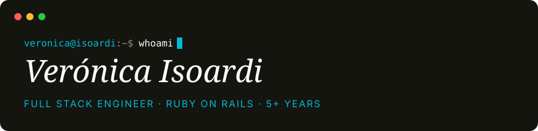

  

  
  
  
  

📍 Buenos Aires, Argentina — remote, overlapping US / EU hours\
🟢 **Open to full-time remote roles.**

Five years and counting on production Rails, owning the interface as much as the system behind it. I design the screens, set up the design system and build the components in Hotwire, Tailwind and ViewComponent, and I take the backend from schema to production. Healthcare, aviation, coaching and e-commerce.

#### `$ git log --career`

💼 **Full Stack Web Developer — [Unagi Software](https://unagisoftware.com/)** · Feb 2021 — present\
Rails consultancy (Clutch Top Rails Developer 2024) working with startups and scaling businesses across English-speaking markets. I own features end to end, from the first screen to the last migration, across six client products.

#### `$ ls ./selected-work`

- 🩺 **Lavela Health** — telehealth · 2025 — now · team of 2\
  Started alone, took it to launch: beta Feb 2026, public May 2026. Two Rails apps in a monorepo so patient data stays strictly separated, Stripe payments, design system and public pages scoring 99/100 on Lighthouse. HIPAA audit under way.
- ✈️ **Argentina Ground Support (AGS)** — aviation operations · 2024—25 · team of 2\
  The system dispatchers run daily across every airport in Argentina, Uruguay and Paraguay. Built from scratch: architecture, REST API, and a mobile-first UI with a Hotwire-powered flight calendar.
- 🧁 **Dulce Sofía** — Ruby 2 / Rails 5 → Ruby 3 / Rails 8 · 2025 · solo\
  Took a live system across four major Rails versions with zero downtime, built the landing page and the native app's notifications module, moved storage from S3 to Cloudflare R2.
- 🔁 **Loop** — peer feedback & performance reviews · 2024—25 · team of 2\
  Designed and co-built from scratch: collaborative reviews, drafts, visibility controls, review cycles, self-assessments and peer feedback.
- 🛍️ **Domaselo** — in-store ordering on tablets · 2022—25 · team of 2\
  Wired into Shopify and the existing order system, with Uber Direct delivery and Klaviyo and Twilio messaging.
- 🧭 **Sayge** — executive coaching platform · 2021—24 · solo, then a team of 3\
  Three years on a B2B platform serving ~30 enterprise clients: user dashboards, the email system, survey workflows, HubSpot and Salesforce integrations.

#### `$ cat stack.txt`

  
  
  
  
  
  
  
  
  
  
  

**Integrations:** Shopify · Stripe · Uber Direct · Twilio · Klaviyo · Salesforce · HubSpot · Stytch

#### `$ cat education.txt`

- 🎓 **Licenciatura en Sistemas** — UNLP, Facultad de Informática · expected 2027 (EU-recognised)
- 🎓 **Analista Programadora Universitaria** — UNLP, Facultad de Informática · graduated
- 🎨 **Diseño Multimedial** — UNLP, Facultad de Artes · partial coursework, where the eye for interface and typography comes from

Off the clock: 🖼️ art · 📚 books · ⚽ football · 🌍 travelling
